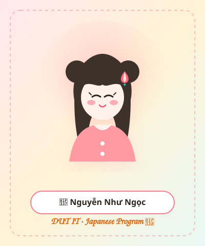
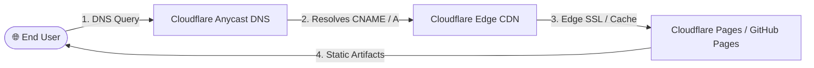

# 🌸 Nguyen Nhu Ngoc — Personal Portfolio

<p align="center">
  
</p>

<p align="center">
  <b>A warm, playful, and responsive paper-craft portfolio showcasing software projects, AI exploration, and research publications.</b>
</p>

<p align="center">
  <a href="https://github.com/nqoc"></a>
  <a href="mailto:ngocdn07@gmail.com"></a>
  
  
</p>

<p align="center">
  <a href="#-about-the-project">About</a> •
  <a href="#-features--design-philosophy">Features</a> •
  <a href="#-tech-stack">Tech Stack</a> •
  <a href="#-project-structure">Structure</a> •
  <a href="#-quick-start">Quick Start</a> •
  <a href="#-deployment--networking-architecture">Deployment & Networking</a> •
  <a href="#-contact">Contact</a>
</p>

---

## 📖 About The Project

This repository hosts the personal portfolio of **Nguyen Nhu Ngoc**, an Information Technology student at **The University of Danang – University of Science and Technology (DUT)**, pursuing the Japanese-language program.

The project fulfills the practical assignment for **Computer Networking (Mạng máy tính) — Week 4**:
* **Frontend:** Built with modern, zero-dependency HTML5, CSS3, and JavaScript featuring a customized paper-craft aesthetic.
* **Infrastructure & Networking:** Deployed on **Cloudflare Pages / GitHub Pages**, managed via **Cloudflare DNS**, routed through a custom domain with full SSL/TLS (HTTPS) encryption enabled 24/7.

---

## ✨ Features & Design Philosophy

* 🎨 **Warm Paper-Craft Aesthetic:** Soft organic textures, hand-drawn paper cutouts, cute pastel stickers (tulips, sakura, paperclips, washi tapes), and gentle shadows.
* ✍️ **Impeccable Typography:** Seamless Vietnamese language support powered by Google Fonts (`Baloo 2` for friendly organic headers and `Nunito` for comfortable readability).
* 📑 **Spotlight on Scientific Research:** Dedicated interactive section featuring the *"Sleep Quality Research"* project and paper preview with full statistical visualization badges.
* 💼 **Comprehensive Showcase:** Highlighting real-world projects such as **SmartMatch AI**, **FairInsight (GDSC)**, **EduApp**, and **AI Rabies Detection**.
* ⚡ **Ultra Lightweight & Fast:** 100% Vanilla implementation. No heavy frameworks, no external runtime bloat, zero audio distractions, fast load time (< 0.5s).
* 📱 **Fully Responsive:** Perfectly adapts across desktops, tablets, and mobile smartphones.
* ♿ **Accessibility First:** Semantic HTML5, accessible contrast ratios, descriptive ARIA attributes, and `prefers-reduced-motion` compliance.

---

## 🛠️ Tech Stack

### Frontend & Styling
* **HTML5:** Semantic architecture, Open Graph metadata, structured content.
* **CSS3:** Custom properties (CSS variables), CSS Grid, Flexbox, keyframe animations, papercraft drop-shadows.
* **Vanilla JavaScript:** Responsive navbar toggling, active scroll spy, smooth in-page navigation, interactive sticker drag/hover effects.

### Infrastructure & Computer Networking
* **Hosting:** Cloudflare Pages / GitHub Pages (Global Edge CDN distribution).
* **DNS Provider:** Cloudflare DNS (Free tier, Anycast routing).
* **Security:** Cloudflare Universal SSL/TLS with automatic HTTPS redirection.
* **Domain:** Custom domain registered via DigitalPlat FreeDomain (`.dpdns.org` / `.us.kg`) or GitHub Student Developer Pack.

---

## 📂 Project Structure

```text
portfolio/
├── assets/
│   ├── avatar-placeholder.svg          # Default chibi/polaroid placeholder
│   ├── favicon.svg                     # Cute tulip/sparkle browser icon
│   └── projects/                       # Illustrated project SVG assets
│       ├── eduapp.svg
│       ├── fairinsight.svg
│       ├── rabies.svg
│       ├── sleep.svg                   # Sleep Quality Research banner
│       └── smartmatch.svg
├── CV_Ngoc_Nguyen_Nhu_FPT_Backend_Intern_EN.pdf # Official Curriculum Vitae
├── DEPLOYMENT_GUIDE.md                 # Detailed step-by-step DNS/hosting guide
├── index.html                          # Main single-page portfolio application
└── README.md                           # Project documentation
```

---

## 🚀 Quick Start (Local Development)

Because this project is built with static web standards, no complex installation or package managers are required.

### Option 1: Live Server in VS Code (Recommended)
1. Clone the repository:
   ```bash
   git clone https://github.com/nqoc/portfolio.git
   cd portfolio
   ```
2. Open the directory in **VS Code**.
3. Install the **Live Server** extension, then right-click `index.html` and choose **"Open with Live Server"**.

### Option 2: Python Built-in HTTP Server
Run the following command inside the project directory:
```bash
python -m http.server 8000
```
Then navigate to `http://localhost:8000` in your browser.

---

## 🌐 Deployment & Networking Architecture

This project demonstrates the core concepts of Internet DNS resolution, Edge CDNs, and HTTPS handshakes:



1. **Nameserver Delegation:** The domain registrar points the authoritative NS records to Cloudflare nameservers (e.g., `*.ns.cloudflare.com`).
2. **DNS Zone Records:** A `CNAME` or `A` record maps root and subdomain (`@` and `www`) to Cloudflare Pages edge endpoint.
3. **Automated SSL/TLS:** Cloudflare issues an Edge Certificate (SNI) ensuring trusted end-to-end HTTPS.

> 📖 For detailed deployment instructions, refer to [DEPLOYMENT_GUIDE.md](file:///D:/HOC_GDGOC/Mmt/portfolio/DEPLOYMENT_GUIDE.md).

---

## 👤 Contact & Connect

* **Full Name:** Nguyen Nhu Ngoc (Nguyễn Như Ngọc)
* **Institution:** The University of Danang – University of Science and Technology (DUT)
* **Program:** Information Technology (Japanese-Language Program)
* **Email:** [ngocdn07@gmail.com](mailto:ngocdn07@gmail.com)
* **GitHub:** [@nqoc](https://github.com/nqoc)

---

<p align="center">
  <i>"Learn continuously. Build thoughtfully. Make technology meaningful." 🌷</i>
</p>
